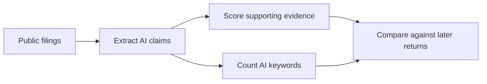

## About me

I write Python for AI research and market simulations, and build web projects in TypeScript. Right now I’m working out how to test what public companies say about AI against what their filings and other public records show.

[Featured work](#featured-work) | [Recent activity](#recent-public-activity) | [All repositories](https://github.com/aryaanay?tab=repositories)

## Featured work

### Can a market maker manage inventory while quoting both sides?

My limit order book notebook models bids, asks, and trades in a synthetic market. It then puts an inventory-aware market maker into that market and tests a case the initial version missed: fills that happen between strategy steps.

[Open the order book notebook](https://github.com/aryaanay/Quantitative-Finance-Model-Development-Portfolio/blob/main/OrderBookSimulator_InventoryAwareMarketMaking.ipynb)

What broke in the first version?

The simulator only checked for fills right after it posted a quote. A fill between strategy steps could leave its inventory count wrong. The fix tracks the order IDs the strategy has placed and checks every new trade for a match. The notebook verifies this by filling a quote between steps and checking that the next step picks it up.

More quant notebooks

- [Implied vs. realized volatility forecasting](https://github.com/aryaanay/Quantitative-Finance-Model-Development-Portfolio/blob/main/OptionsVolatility_ImpliedVsRealizedForecasting.ipynb)
- [Pairs trading and statistical arbitrage](https://github.com/aryaanay/Quantitative-Finance-Model-Development-Portfolio/blob/main/PairsTradingSystem_StatisticalArbitrage.ipynb)
- [Market regime detection with a hidden Markov model](https://github.com/aryaanay/Quantitative-Finance-Model-Development-Portfolio/blob/main/RegimeDetection_HMMBasedMarketRegimeStrategy.ipynb)
- [Hybrid cryptocurrency price prediction](https://github.com/aryaanay/Quantitative-Finance-Model-Development-Portfolio/blob/main/CryptoPricePredictionHybridModel.ipynb)

### What do corporate AI claims tell us about future returns?

[AI Narrative Reality Gap](https://github.com/aryaanay/ai-narrative-reality-gap#readme) lays out a study of S&P 100 companies. The plan compares a score based on evidence behind AI claims with a baseline that counts AI keywords. Data collection is next.

[Read the research plan](https://github.com/aryaanay/ai-narrative-reality-gap#plan) | [See the data sources](https://github.com/aryaanay/ai-narrative-reality-gap#data)

### Other projects

- [Build, Review, and Release](https://github.com/aryaanay/build-review-release#readme) is a Codex skill for planning projects, testing them, and checking what’s ready to publish.
- [TSA Webmaster](https://github.com/aryaanay/tsa-webmaster#readme) is a Next.js project with instructions to run it locally.

## Recent public activity

<!-- activity:start -->
- **Nov 24, 2026** — Updated code in [build-review-release](https://github.com/aryaanay/build-review-release/commits)
- **Nov 24, 2026** — Opened repository in [build-review-release](https://github.com/aryaanay/build-review-release)
- **Nov 19, 2026** — Updated code in [ai-narrative-reality-gap](https://github.com/aryaanay/ai-narrative-reality-gap/commits)
- **Nov 19, 2026** — Opened repository in [ai-narrative-reality-gap](https://github.com/aryaanay/ai-narrative-reality-gap)
<!-- activity:end -->

## Get in touch

Found a bug or want to discuss a method? Open an issue in the relevant repository.
